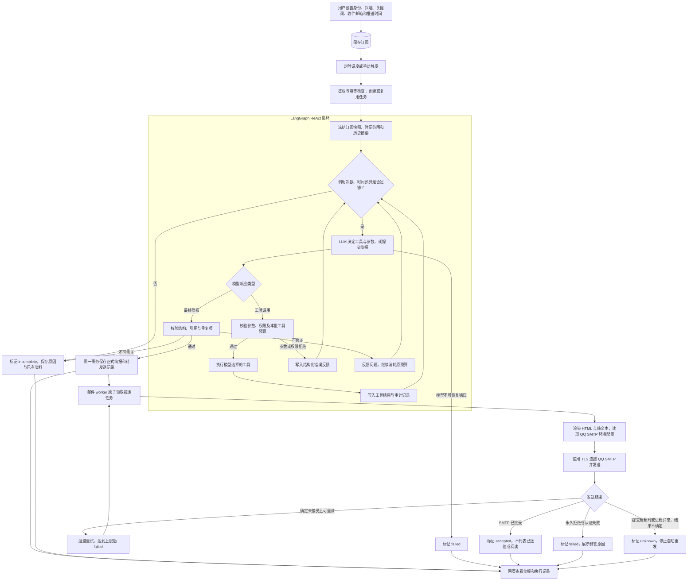

# 每日 AI 新闻助手运行流程
更新：2026-11-22。此图是待实现目标，QQ SMTP 发送不在模型工具集合中。
部署统一采用 Docker Compose：未来 api/worker 共享数据库卷，前端由独立服务提供。
当前仅落地检查和初始化服务，详见[运行说明](07-Docker-Compose运行说明.md)。

## 图中重要边界
1. 工具是可选能力，不是固定流水线；不要求每次调用所有工具。
2. 预算在模型调用前检查；工具批次执行前预留本批次数，避免一次响应突破上限。
3. 不完整结果可供查看，但默认不自动发送；零条可靠新闻可提交明确的“本期暂无可靠新闻”简报。
4. 简报和投递记录在一个事务中提交，网络发送在事务外执行。
5. SMTP 无业务幂等接口；唯一投递记录只能防并发重复，不能保证外部严格 exactly-once。
6. 发送结果未知与明确失败必须分开；未知状态需用户核查，Message-ID 相同也不能保证收件方去重。
